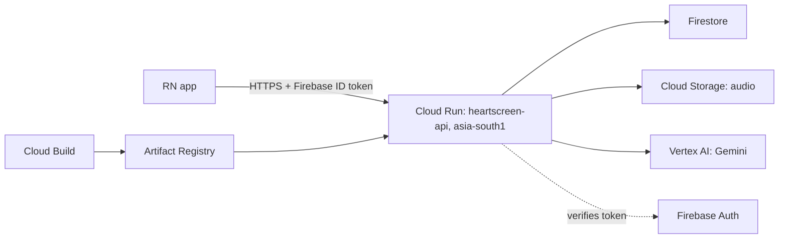

# HridAI Backend: Deploy to Google Cloud

> **Status: not yet run.** There's no backend code to deploy yet, and `gcloud` isn't installed on the dev machine. Every `gcloud run deploy` and `gcloud storage buckets create` flag was checked against Google's reference docs, but expect small fixes on the first real run.
> Commands are for **PowerShell**. See `REVIEW.md` for the reasons behind these choices.

## What you'll end up with



| Decision | Choice | Why |
|----------|--------|-----|
| Project | One project for GCP and Firebase | Tokens verify without extra config |
| Identity | Dedicated service account | The default one may hold Editor |
| Gemini | Vertex AI | No API key; data isn't used for training |
| Model | Baked into the image | Code and model version together |
| Deploys | Build an image, then deploy that image | Repeatable, and rollback is instant |

## Before the first deploy

The code must do these, or the steps below will fail. All are PLAN B0/B2 work.

- [ ] Listens on `$PORT`.
- [ ] Serves `GET /health`, keeping `/healthz` for local use.
- [ ] Refuses to start if `ENV=prod` with `AUTH_MODE=dev`, `DATA_BACKEND=memory`, or any `MOCK_*=true`.
- [ ] Accepts `ENV=staging`.
- [ ] Reads the Vertex settings shown in step 7 when `GEMINI_MODEL` is set.
- [ ] Runs in Docker locally: start Docker Desktop, then `docker build backend`.

## 1. Install tools and sign in

```powershell
winget install Google.CloudSDK
npm install -g firebase-tools
```

Open a new terminal, then:

```powershell
gcloud auth login
gcloud auth application-default login
firebase login
```

The second command gives local code cloud access, so **you don't need `sa.json`**.

## 2. Create the project

Pick a globally unique ID. The name below is an example. Find your billing ID with `gcloud billing accounts list`.

```powershell
$P = "heartscreen-abc"
$R = "asia-south1"
$BILLING = "XXXXXX-XXXXXX-XXXXXX"

gcloud projects create $P --name="HridAI"
gcloud billing projects link $P --billing-account=$BILLING
gcloud config set project $P
gcloud config set run/region $R
```

Set a budget alert straight away. Alerts notify you but don't stop spending.

```powershell
gcloud services enable billingbudgets.googleapis.com
gcloud billing budgets create --billing-account=$BILLING --display-name="hridai" --budget-amount=20USD --threshold-rule=percent=0.5 --threshold-rule=percent=0.9 --threshold-rule=percent=1.0
```

Enable the services:

```powershell
gcloud services enable run.googleapis.com cloudbuild.googleapis.com artifactregistry.googleapis.com firestore.googleapis.com storage.googleapis.com aiplatform.googleapis.com firebase.googleapis.com identitytoolkit.googleapis.com
```

## 3. Add Firebase

```powershell
firebase projects:addfirebase $P
```

Then, in the [Firebase console](https://console.firebase.google.com/):

1. **Authentication → Sign-in method:** enable **Anonymous**.
2. **Project settings → Your apps:** add the app and send the config to the app developer for `EXPO_PUBLIC_FIREBASE_*`.

## 4. Create Firestore and storage

```powershell
gcloud firestore databases create --location=$R --type=firestore-native
```

Save this as `backend/lifecycle.json`. It deletes audio after 30 days as a backstop. Change the number if you need a different retention period.

```json
{ "rule": [ { "action": { "type": "Delete" }, "condition": { "age": 30, "matchesPrefix": ["screenings/"] } } ] }
```

```powershell
$BUCKET = "$P-data"
gcloud storage buckets create "gs://$BUCKET" --location=$R --uniform-bucket-level-access --public-access-prevention --soft-delete-duration=0 --lifecycle-file=backend/lifecycle.json
gcloud storage buckets create "gs://$P-ml" --location=$R --uniform-bucket-level-access --public-access-prevention
```

`--soft-delete-duration=0` is what makes `DELETE` really delete audio. The `-ml` bucket keeps model files; soft delete stays on there as a safety net, and the running service doesn't need access to it.

Add these three files to `backend/`:

`firestore.rules`

```text
rules_version = '2';
service cloud.firestore {
  match /databases/{database}/documents {
    match /{document=**} { allow read, write: if false; }
  }
}
```

`firestore.indexes.json`

```json
{
  "indexes": [
    {
      "collectionGroup": "screenings",
      "queryScope": "COLLECTION",
      "fields": [
        { "fieldPath": "owner_uid", "order": "ASCENDING" },
        { "fieldPath": "created_at", "order": "DESCENDING" }
      ]
    }
  ],
  "fieldOverrides": []
}
```

`firebase.json`

```json
{ "firestore": { "rules": "firestore.rules", "indexes": "firestore.indexes.json" } }
```

```powershell
Push-Location backend
firebase deploy --only firestore --project $P
Pop-Location
```

## 5. Create the runtime identity

```powershell
$SA = "heartscreen-api@$P.iam.gserviceaccount.com"
gcloud iam service-accounts create heartscreen-api --display-name="HridAI API"

gcloud projects add-iam-policy-binding $P --member="serviceAccount:$SA" --role="roles/datastore.user"
gcloud projects add-iam-policy-binding $P --member="serviceAccount:$SA" --role="roles/aiplatform.user"
gcloud storage buckets add-iam-policy-binding "gs://$BUCKET" --member="serviceAccount:$SA" --role="roles/storage.objectUser"
```

No Firebase role is needed to verify ID tokens. Only when heatmaps (B9) need signed URLs, add:

```powershell
gcloud iam service-accounts add-iam-policy-binding $SA --member="serviceAccount:$SA" --role="roles/iam.serviceAccountTokenCreator"
```

## 6. Set up image builds

```powershell
gcloud artifacts repositories create heartscreen --repository-format=docker --location=$R
$N = gcloud projects describe $P --format="value(projectNumber)"
gcloud projects add-iam-policy-binding $P --member="serviceAccount:$N-compute@developer.gserviceaccount.com" --role="roles/run.builder"
```

`backend/Dockerfile`

```dockerfile
FROM python:3.11-slim-bookworm

# ENV=prod is the safe default: staging has to opt out explicitly.
ENV PYTHONUNBUFFERED=1 PYTHONDONTWRITEBYTECODE=1 OMP_NUM_THREADS=1 ENV=prod

RUN apt-get update \
  && apt-get install -y --no-install-recommends ffmpeg \
  && rm -rf /var/lib/apt/lists/*

WORKDIR /srv
COPY requirements.txt .
RUN pip install --no-cache-dir -r requirements.txt
COPY app ./app
COPY models ./models

RUN useradd --uid 10001 --no-create-home appuser
USER appuser

CMD ["sh", "-c", "exec uvicorn app.main:app --host 0.0.0.0 --port ${PORT:-8080} --workers 1"]
```

`models/` must exist for `COPY` to work, so the mock build needs a placeholder file in it.

`backend/.gcloudignore` and `backend/.dockerignore` (same content). Without these, gcloud may skip `models/` or upload local files:

```text
.git
.venv/
__pycache__/
*.pyc
.pytest_cache/
.ruff_cache/
.env
sa.json
local_data/
tests/
docs/
```

Check what will be uploaded. `models/` must be listed, and `.env` must not.

```powershell
gcloud meta list-files-for-upload backend
```

## 7. Deploy

### Build the image

Use the git commit as the tag, so every image traces back to its code.

```powershell
$SHA = git rev-parse --short HEAD
$IMAGE = "$R-docker.pkg.dev/$P/heartscreen/api:$SHA"
gcloud builds submit backend --tag $IMAGE
```

For real inference, first copy the model in:

```powershell
gcloud storage cp --recursive "gs://$P-ml/models/<model_version>/*" backend/models/
```

### Stage A: mock API for the app developer (B2)

Save as `backend/deploy/staging.env.yaml`:

```yaml
ENV: "staging"
AUTH_MODE: "dev"
DATA_BACKEND: "memory"
MOCK_INFERENCE: "true"
MOCK_QUALITY: "true"
MOCK_SCENARIO: "cycle"
CORS_ORIGINS: "*"
```

```powershell
gcloud run deploy heartscreen-api --image=$IMAGE --region=$R --service-account=$SA --allow-unauthenticated --env-vars-file=backend/deploy/staging.env.yaml --cpu=1 --memory=1Gi --concurrency=4 --timeout=60 --min-instances=0 --max-instances=1
```

Dev auth is open to anyone with the URL, so share it only with the team and send no real data. Data is lost whenever the instance shuts down. Move to Stage B as soon as B3 is done.

### Stage B: real backend (B3 onward)

Save as `backend/deploy/prod.env.yaml`, using your own project and bucket names. Set the mock flags to `"false"` as each phase lands; the service refuses to start in `prod` while any is `"true"`, so run with `ENV: "staging"` until then.

```yaml
ENV: "prod"
AUTH_MODE: "firebase"
DATA_BACKEND: "firestore"
MOCK_INFERENCE: "false"
MOCK_QUALITY: "false"
MODEL_PATH: "/srv/models/model.onnx"
GCP_PROJECT: "heartscreen-abc"
STORAGE_BUCKET: "heartscreen-abc-data"
GOOGLE_GENAI_USE_VERTEXAI: "true"
GOOGLE_CLOUD_PROJECT: "heartscreen-abc"
GOOGLE_CLOUD_LOCATION: "asia-south1"
GEMINI_MODEL: "gemini-3.5-flash"
GEMINI_TIMEOUT_S: "15"
CORS_ORIGINS: ""
```

`CORS_ORIGINS` is empty because a native app doesn't use CORS. Add origins only for Expo web. `GOOGLE_GENAI_USE_VERTEXAI`, `GOOGLE_CLOUD_PROJECT` and `GOOGLE_CLOUD_LOCATION` are the `google-genai` SDK's standard settings; these replace `GEMINI_API_KEY`.

```powershell
gcloud run deploy heartscreen-api --image=$IMAGE --region=$R --service-account=$SA --allow-unauthenticated --env-vars-file=backend/deploy/prod.env.yaml --cpu=2 --memory=4Gi --concurrency=4 --timeout=60 --cpu-boost --min-instances=0 --max-instances=3
```

| Flag | Why |
|------|-----|
| `--allow-unauthenticated` | The app has no Google IAM identity. The API checks Firebase tokens itself |
| `--cpu=2 --memory=4Gi` | Plan starting point. Lower it after the B8 load test, especially on ONNX |
| `--concurrency=4` | Inference is CPU-bound; don't raise it without testing |
| `--cpu-boost` | Extra CPU during startup, for faster cold starts |
| `--max-instances=3` | Caps cost. Allows 12 requests at once |
| `--timeout=60` | Above the app's 45 s timeout |

If your organization blocks public services, use `--no-invoker-iam-check` instead of `--allow-unauthenticated`.

The default startup probe (TCP, 240 s) is fine, because uvicorn opens the port only after the model has loaded.

## 8. Check it works

```powershell
$URL = gcloud run services describe heartscreen-api --region=$R --format="value(status.url)"
Invoke-RestMethod "$URL/health"
```

Confirm `/healthz` for review finding 2. A Google-styled 404 means the path is reserved.

```powershell
curl.exe -i "$URL/healthz"
```

Test real auth. The Web API key is in Firebase project settings. This creates one anonymous test user.

```powershell
$KEY = "<firebase-web-api-key>"
$TOKEN = (Invoke-RestMethod -Method Post -ContentType "application/json" -Body '{"returnSecureToken":true}' -Uri "https://identitytoolkit.googleapis.com/v1/accounts:signUp?key=$KEY").idToken
Invoke-RestMethod -Headers @{ Authorization = "Bearer $TOKEN" } "$URL/v1/screenings"
```

Then confirm these before you share the URL:

- [ ] A call with no token returns 401.
- [ ] In prod, `Bearer dev:test` returns 401.
- [ ] `scripts/smoke_test.ps1` passes against `$URL`.
- [ ] After `DELETE`, the Firestore document and the audio are both gone.
- [ ] Logs contain no patient fields.

Send `$URL` to the app developer for `EXPO_PUBLIC_API_BASE_URL`.

## 9. Monitor

```powershell
gcloud run services logs read heartscreen-api --region=$R --limit=50
```

In the console:

1. **Monitoring → Uptime checks:** add a check on `$URL/health`.
2. **Monitoring → Alerting:** alert on Cloud Run 5xx responses.
3. **Logging:** add a log-based alert on `gemini_fallback=true`, which shows when explanations silently fall back to templates.

## 10. Release and roll back

Normal release: build a new image (step 7), then deploy it with the same command.

For a safer release, send it no traffic and test it first:

```powershell
gcloud run deploy heartscreen-api --image=$IMAGE --region=$R --no-traffic --tag=canary
```

Test the `https://canary---...run.app` URL that this prints, then switch over:

```powershell
gcloud run services update-traffic heartscreen-api --region=$R --to-latest
```

Roll back in seconds:

```powershell
gcloud run revisions list --service=heartscreen-api --region=$R
gcloud run services update-traffic heartscreen-api --region=$R --to-revisions=<good-revision>=100
```

## 11. Demo day

30 minutes before:

```powershell
gcloud run services update heartscreen-api --region=$R --min-instances=1
Invoke-RestMethod "$URL/health"
```

Run one full screening to warm everything. Afterwards:

```powershell
gcloud run services update heartscreen-api --region=$R --min-instances=0
```

Don't leave this on: a minimum instance bills all day.

## Cost

Rough figures only. The rates below came from a cached copy of the pricing page, so confirm them in the [pricing calculator](https://cloud.google.com/products/calculator). `asia-south1` is Tier 1.

| Item | Estimate |
|------|----------|
| Cloud Run, scale to zero, demo traffic | About $0; likely inside the free tier |
| `--min-instances=1` at 2 vCPU, 4 GiB | About $1.30/day idle (≈ $0.0000025 per vCPU-second and GiB-second) |
| Firestore, Storage, Artifact Registry | Cents to a few dollars a month at this scale |
| Gemini | Low per call. Check current prices for your model |

## Optional: automate deploys

After the demo, add GitHub Actions: run `ruff` and `pytest` on every push, then build and deploy from `main`. Sign in with **Workload Identity Federation**, not a stored JSON key.

## After the hackathon

ctx §16 says to delete hackathon data after the event unless the team decides otherwise. Review the list before running this, because it **cannot be undone**.

```powershell
gcloud storage ls "gs://$BUCKET/screenings/"
gcloud storage rm --recursive "gs://$BUCKET/screenings/"
firebase firestore:delete --all-collections --project $P
```

To remove everything and stop all charges, delete the project in the console. Google holds it for a recovery period before it's permanently removed.

## Troubleshooting

| Symptom | Likely cause |
|---------|--------------|
| Container failed to start on `$PORT` | Crash at startup, usually the prod safety check or a missing model. Check the logs |
| 403 from Google on every call | `--allow-unauthenticated` is missing or blocked by policy |
| 401 on a valid token | Firebase and `GCP_PROJECT` don't match |
| 403 / `PERMISSION_DENIED` in logs | A role from step 5 is missing, or was granted seconds ago |
| Gemini always falls back | Wrong model ID, wrong `GOOGLE_CLOUD_LOCATION`, or the Vertex role is missing |
| Google 404 on `/healthz` | Reserved path. Use `/health` |
| Model file missing in the container | Not copied before the build, or excluded by `.gcloudignore` |
| Out of memory | Files in `/tmp` count as memory. Clean up temp files, or raise `--memory` |
| `--set-env-vars` parse errors | PowerShell treats commas as arrays. Use `--env-vars-file` as shown here |
