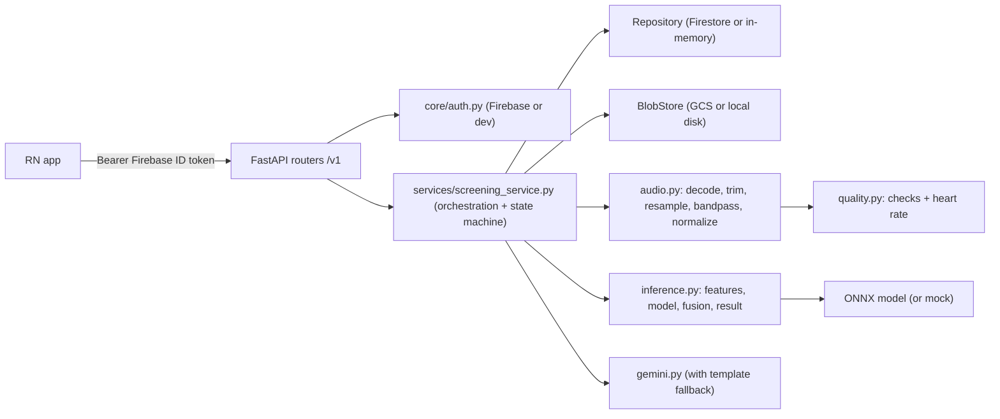
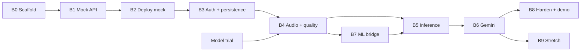

# HridAI Backend: Build Plan

> Status: **B0 and B1 done; mock API runs locally.** Track progress by ticking boxes (`- [x]`) and updating `HANDOFF.md`.
> Source of truth for requirements: `../../heart-screening-context.html` (summarised for the backend in `SPEC.md`).
> Updated 2026-10-31 with the non-contract findings from `REVIEW.md`. Deployment steps are in `DEPLOY.md`.

---

## 1. Goals

| # | Goal | Done when |
|---|------|-----------|
| G1 | **Unblock the mobile app early** | Full v1 API runs in mock mode, locally and on Cloud Run, with no cloud credentials needed locally |
| G2 | **Reliable quality gate** | Bad recordings are rejected with the right issue code and bilingual message; heart rate is estimated |
| G3 | **Real screening result** | `/analyze` runs the exported ONNX model + threshold → label/confidence (metadata fusion only if it proves itself, see B5) |
| G4 | **Bilingual explanation** | Gemini explanation in EN + HI with a template fallback that is always available |
| G5 | **Deployed and demo-ready** | Cloud Run asia-south1, min-instances 1 on demo day, p95 analyze < 15 s |
| G6 | **Privacy by default** | No PII stored or logged, delete endpoint removes everything, client access denied |

Non-goals: murmur type classification, ECG, on-device model, doctor dashboard, queues/workers, clinical validation.

---

## 2. Architecture



### Layering rules

- **Routers** (`app/api/`) only: parse/validate input, call the service, map to response schemas. No business logic.
- **Service** (`app/services/screening_service.py`) owns the screening state machine and orchestration.
- **Adapters** behind small interfaces (Python `Protocol`) so everything runs offline:
  - `Repository`: `FirestoreRepository` | `InMemoryRepository` (selected by `DATA_BACKEND=firestore|memory`)
  - `BlobStore`: `GCSBlobStore` | `LocalBlobStore` (selected by `DATA_BACKEND`)
  - `Classifier`: `OnnxClassifier` | `MockClassifier` (selected by `MOCK_INFERENCE`)
  - `Explainer`: `GeminiExplainer` | `TemplateExplainer` (Gemini wraps the template as fallback)
  - Auth: `AUTH_MODE=firebase|dev`. Dev mode accepts `Bearer dev:<uid>` (`ENV=local|staging` only).
- **Fail closed:** the app refuses to start if `ENV=prod` with `AUTH_MODE=dev`, `DATA_BACKEND=memory` or any `MOCK_*=true`. The Dockerfile sets `ENV=prod`, so staging must opt out explicitly.
- **Route handlers are plain `def`**, not `async def`. Firestore, GCS and token verification are sync clients and would block the event loop.
- **Pure functions** for DSP, quality, features and result logic, so they are easy to unit-test and to import from `ml/`.
- Dependencies are wired once in `app/api/deps.py` (FastAPI `Depends`) and created at startup in the `lifespan` handler (model loaded once).

### Target directory layout

```text
backend/
├── AGENTS.md / CLAUDE.md / GEMINI.md   # AI assistant entry points
├── README.md
├── pyproject.toml          # the one dependency list; package "app", ruff + pytest config; `pip install -e backend` from ml/
├── uv.lock                 # exact versions
├── requirements.txt        # exported from uv.lock for Docker; never edited by hand
├── requirements-dev.txt    # exported from uv.lock: pytest, httpx2, ruff
├── .env.example
├── Dockerfile
├── .dockerignore
├── .gcloudignore           # must NOT exclude models/
├── firebase.json           # + firestore.rules, firestore.indexes.json
├── lifecycle.json          # bucket retention rule
├── deploy/                 # staging.env.yaml, prod.env.yaml (no secrets)
├── docs/                   # PLAN.md, SPEC.md, HANDOFF.md, REVIEW.md, DEPLOY.md
├── app/
│   ├── main.py             # create_app(), lifespan (load model, init clients), middleware
│   ├── schemas.py          # Pydantic request/response models (mirror SPEC §2 exactly)
│   ├── api/
│   │   ├── deps.py         # get_settings, get_current_uid, get_service
│   │   ├── health.py       # GET /healthz
│   │   └── screenings.py   # /v1/screenings routes
│   ├── core/
│   │   ├── config.py       # Settings (pydantic-settings)
│   │   ├── audio_config.py # ALL DSP/feature constants (shared with ml/)
│   │   ├── auth.py         # Firebase ID token verification + dev mode
│   │   ├── errors.py       # ApiError, error codes, bilingual messages, exception handlers
│   │   ├── messages.py     # quality issue messages + disclaimer + label headlines (EN/HI)
│   │   ├── ids.py          # new_id("scr") -> "scr_8f2k1xq0ab"
│   │   └── logging.py      # JSON logs, request-id middleware, no PII
│   ├── services/
│   │   ├── audio.py        # decode (ffmpeg), trim, resample, bandpass, normalize, segment
│   │   ├── quality.py      # quality checks + heart-rate estimate -> QualityReport
│   │   ├── features.py     # log-mel per window + standardization
│   │   ├── model.py        # Classifier protocol, OnnxClassifier, MockClassifier
│   │   ├── fusion.py       # optional metadata late fusion (weights from JSON), default = audio only
│   │   ├── result.py       # label/confidence/unclear rules, per-location aggregation
│   │   ├── gemini.py       # explanation + report summary, JSON mode, timeout, fallback
│   │   ├── templates.py    # fixed EN/HI explanation text per label
│   │   ├── repository.py   # Repository protocol + Firestore + InMemory
│   │   ├── storage.py      # BlobStore protocol + GCS + Local, signed URLs
│   │   └── screening_service.py
│   └── prompts/
│       ├── explanation.txt
│       └── report_summary.txt
├── models/                 # gitignored, baked into the image: model.onnx, model_meta.json, optional fusion.json
├── scripts/
│   ├── make_test_audio.py  # synthesizes heartbeat / noise / silence / clipped WAVs for tests
│   └── smoke_test.ps1      # end-to-end calls against a running server
└── tests/
    ├── conftest.py         # TestClient with memory backend, dev auth, mock inference
    ├── fixtures/audio/     # small generated WAV/M4A samples
    ├── test_health.py
    ├── test_screenings_api.py
    ├── test_audio.py
    ├── test_quality.py
    ├── test_result.py
    ├── test_gemini_fallback.py
    └── test_auth.py
```

---

## 3. Phases

Each phase ends with something runnable. Order is chosen so the app team is unblocked first (B1–B2), then real features replace mocks one by one.



### Model trial — do first, in parallel with B0 (≈ 1 day)

This decides the audio constants, so it must finish before B4 and B5 freeze them.

- [x] Get CardioPHON; confirm weights exist (encoder only, 24.2 MB)
- [x] Confirm sample rate and input shape (4 kHz, `[N, 1, 64, T]`, any length); ONNX export tested
- [x] Write the training notebook: `ml/notebooks/train_cardiophon_head.ipynb` (tested end to end on 120 patients)
- [x] Run the notebook on all patients in Colab, and put the zip's files in `backend/models/`
- [x] Update `SPEC.md` §4 and §4.4, and record the outcome in `HANDOFF.md`
- [ ] Licence: user chose a 2-day private demo and will email the authors later; ask before any wider use

### B0 — Scaffold and tooling (≈ 0.5 day)

- [x] `pyproject.toml` (package `app`, Python 3.11, ruff config, pytest config) + `uv.lock`
- [x] `requirements.txt` + `requirements-dev.txt` exported from `uv.lock`
- [x] `.env.example`, `.gitignore`, `.dockerignore`, `.gcloudignore` (ignore `.venv`, `sa.json`, `.env`, `local_data/`; `.gitignore` also ignores `models/`, but `.dockerignore` and `.gcloudignore` must not)
- [x] `app/core/config.py` with all settings from SPEC §7 and local defaults (`DATA_BACKEND=memory`, `AUTH_MODE=dev`, `MOCK_INFERENCE=true`); `ENV=local|staging|prod`
- [x] Startup check: refuse to start if `ENV=prod` with dev auth, memory storage or any mock
- [x] `app/main.py` `create_app()` + `lifespan`; `GET /healthz`
- [x] `app/core/logging.py`: JSON logger, `X-Request-ID` middleware (generate if absent, echo in response)
- [x] `app/core/errors.py`: `ApiError(status, code)` + handlers that produce the SPEC error envelope, including for FastAPI validation errors (→ 400 `invalid_request`, not 422; never log or echo the raw error body, it can hold patient fields) and unhandled errors (→ 500 `internal_error`, log request id)
- [x] `tests/test_health.py` passes; `ruff check .` clean

**Accept:** `uvicorn app.main:app --reload` runs on Windows; `/healthz` returns `{"status":"ok","model_version":...,"mock":true}`.

### B1 — Full v1 API in mock mode (≈ 1 day) — **unblocks the app**

- [x] `app/schemas.py`: every request/response model in SPEC §2 (enums for `Location`, `Sex`, `Symptom`, `KnownCondition`, `Label`, `QualityIssue`, `ScreeningStatus`, `Source`, `Platform`, `Lang`)
- [x] `app/core/ids.py`, `app/core/messages.py` (all EN/HI strings from SPEC)
- [x] `InMemoryRepository` + `LocalBlobStore` (writes under `local_data/`)
- [x] `app/core/auth.py` dev mode (`Bearer dev:<uid>`); missing/invalid → 401 `unauthorized`
- [x] `screening_service.py` state machine: `awaiting_recordings → ready → analyzing → completed | failed`
- [x] `POST /v1/screenings` (validate consent accepted = true, age 0–110, required fields)
- [x] `POST /v1/screenings/{id}/recordings` (multipart; validate location/source/platform; size ≤ 5 MB → 413, rejected on `Content-Length` in middleware and by counting bytes while reading, because Starlette parses the body before the handler runs; content type/extension → 415; replace previous recording for same location)
- [x] `MockQuality`: accepts unless `duration_ms < 8000` (→ `too_short`); returns realistic score/bpm
- [x] `POST /v1/screenings/{id}/analyze` with `MockClassifier` + `TemplateExplainer`; 409 `no_accepted_recordings`
- [x] `GET /v1/screenings/{id}`, `GET /v1/screenings?limit=20` (newest first, owner only), `DELETE /v1/screenings/{id}` (204, deletes blobs)
- [x] Ownership: other user's screening → 404 `screening_not_found` (never 403, never leak existence)
- [x] Patient profiles: `/v1/patients` create, list, read, patch and delete (delete cascades to screenings and audio); `POST /v1/screenings` takes `patient_id` and stores a snapshot without the label; `GET /v1/screenings?patient_id=`
- [x] `NK` neck location: upload and mock quality work, excluded from status, analyze and the result; neck messages never say to press harder
- [x] `MOCK_SCENARIO=normal|needs_checkup|unclear|cycle` env var to let the app team test every result screen
- [x] CORS enabled for local Expo web dev (configurable origins)
- [x] API tests for every endpoint, every error code, and the full happy path
- [ ] Export `openapi.json` and share with the app dev; confirm field names match SPEC §2 TypeScript types

**Accept:** full flow works with curl/`scripts/smoke_test.ps1`; responses byte-for-byte match SPEC examples in shape.

### B2 — Containerise and deploy mock to Cloud Run (≈ 0.5 day)

Follow `DEPLOY.md`.

- [x] `Dockerfile`: pinned `python:3.11-slim-bookworm`, `ENV=prod`, `apt-get install --no-install-recommends ffmpeg`, non-root user, `uvicorn` on `$PORT`
- [ ] One project for GCP and Firebase, budget alert, Firestore (native, asia-south1), data bucket (soft delete off, 30-day lifecycle rule), ML bucket *(user runs these)*
- [ ] Dedicated service account: `roles/datastore.user` and `roles/aiplatform.user` on the project, `roles/storage.objectUser` on the data bucket only
- [ ] Artifact Registry repository; build a tagged image, then deploy it (DEPLOY.md Stage A: `ENV=staging`, dev auth, memory storage, `--max-instances=1`)
- [ ] Send Cloud Run URL to app dev (`EXPO_PUBLIC_API_BASE_URL`), and warn that staging data can vanish and the URL has dev auth, so no real data

**Accept:** `/healthz` on the public Cloud Run URL; app dev can call the mock API from a phone.

### B3 — Real auth and persistence (≈ 1 day)

- [x] Firebase Admin init with Application Default Credentials everywhere (`gcloud auth application-default login` locally; no `sa.json`)
- [x] `verify_id_token` (phone login; `check_revoked=False` for speed); `AUTH_MODE=dev` refused when `ENV=prod`
- [x] Analysis lock: set `analyzing` in a Firestore transaction with `analysis_started_at`; treat it as expired after 90 s so a crash or timeout can't block retries; a live lock → 409 `analysis_in_progress`
- [x] `FirestoreRepository` matching SPEC §3 collections (`patients`, `screenings`, sub-collections `recordings`, `reports`); list queries by `owner_uid` + `created_at desc`, `owner_uid` + `patient_id` + `created_at desc` and `owner_uid` + `last_activity_at desc` (create composite indexes; commit `firestore.indexes.json`)
- [x] `GCSBlobStore`: upload original + converted WAV, delete prefix, signed URL (15 min) for heatmaps (B9 only; add the token-creator role then)
- [x] Deny all client access: commit `firestore.rules`; the bucket uses uniform access + public access prevention, so IAM controls it
- [x] Delete cascades: Firestore sub-collections + `screenings/{id}/` storage prefix (soft delete must be off, or audio stays recoverable for 7 days)
- [x] Same API test-suite runs against memory backend in CI; a manual/opt-in test against real Firebase (`pytest -m cloud`)

**Accept:** a phone login token works end-to-end on Cloud Run; data visible in Firestore console; delete leaves nothing behind.

### B4 — Audio pipeline and quality check (≈ 1.5 days)

- [ ] `app/core/audio_config.py`: every constant from SPEC §4 in one frozen dataclass
- [x] `audio.decode()` via ffmpeg subprocess: write the upload to a temp file (not stdin; a default-muxed m4a returned exit code 0 and 0 bytes over stdin) and delete it afterwards, output `-ac 1 -ar <native> -f f32le pipe:1`
- [x] Harden ffmpeg: `-protocol_whitelist file`, allow only m4a/mp4/wav input formats, `-t 35`, subprocess timeout; raise `unsupported_audio` (415) on decode failure **or empty output**
- [x] `preprocess` (resample, trim 1 s each side, peak normalize) in `app/services/audio.py`, shared with training
- [x] `bandpass` (Butterworth order 4, 25–400 Hz, `sosfiltfilt`) for quality checks only; the model gets unfiltered audio
- [ ] Optional spike removal (Schmidt) behind a flag, default off
- [x] `quality.py` runs **before** `peak_normalize`, in order: `too_short`, `clipping` (on decoded audio), `too_quiet` (filtered RMS), `too_noisy` (SPEC §4.1: energy at S1/S2 vs between beats, mains hum at 50/100/150 Hz, spectral flatness), heartbeat envelope + autocorrelation searched over 30–220 bpm → `no_heartbeat_detected`, then range check 40–180 → `heart_rate_out_of_range`; score 0–1 combining the sub-metrics
- [ ] Store converted 4 kHz WAV next to original in BlobStore
- [ ] `scripts/make_test_audio.py`: synthetic lub-dub at 60/78/120 bpm, white noise, silence, clipped, 5 s short, 50 Hz hum
- [ ] Unit tests per check with synthetic audio; bpm within ±5 of truth
- [ ] Replace `MockQuality` with real quality **even in mock inference mode** (flag `MOCK_QUALITY=false` default once done)
- [ ] Threshold tuning notebook/script: run quality on PhysioNet good vs CirCor "unknown" + ~20 consented team phone recordings (quiet, fan, talking); write chosen thresholds to `audio_config.py` and results to `docs/HANDOFF.md`
- [ ] Check bpm on real recordings too: synthetic tests passed, but a strong S2 could cause rate doubling
- [ ] Separate neck (`NK`) quality thresholds, tuned on ~20 consented team recordings (at rest, breathing heavily, swallowing, talking); stay loose until then and log outcome counts

**Accept:** real phone m4a uploads are accepted in a quiet room and rejected with `too_noisy` with a fan on; all quality tests pass.

### B5 — Real inference (≈ 1 day, after a model exists from B7/ml)

- [x] `features.py`: log-mel in numpy/scipy, no librosa at runtime, values from `audio_config.py`, matched to nnAudio by a golden test
- [x] `OnnxClassifier`: load once at startup from `MODEL_PATH` (file baked into the image), `intra_op_num_threads=1`, one recording at a time; a semaphore of 2 around inference
- [x] Validate `model_meta.json` against `audio_config.py` at startup and refuse to start on a mismatch
- [x] Aggregation: recording → screening = max over locations
- [ ] `fusion.py`: **off for MVP** (`used_patient_data=false`). If `FUSION_PATH` is set, load the JSON (logistic regression coefficients, medians, feature order). Ship it only if it beats audio-only on held-out data with the missing flags removed
- [x] `result.py`: unclear rule (no accepted recordings / all quality < 0.5), threshold from `model_meta.json`, confidence rule, `confidence_band` helper
- [x] Run analyze synchronously in a plain `def` route; take the lock from B3, then `completed`/`failed`; on failure store `failed` and return 500 with request id
- [ ] Golden test: fixed WAV + fixed tiny test model → fixed probability (guards preprocessing drift)
- [x] `/healthz` reports real `model_version`, `mock=false`

**Accept:** with `MOCK_INFERENCE=false`, demo murmur sample → `needs_checkup`, demo normal → `normal`; analyze p95 < 5 s excluding Gemini.

### B6 — Gemini integration (≈ 0.5 day)

- [ ] `google-genai` client on **Vertex AI** in `asia-south1` with the service account (no API key), model from `GEMINI_MODEL` (pin `gemini-3.5-flash`), temperature 0.2, JSON response (`response_mime_type="application/json"` + response schema), 15 s timeout
- [ ] Explanation prompt from SPEC §5; input payload contains **only** label, probabilities, bpm, locations, age, sex, symptoms, report summaries
- [ ] Validate output (both `en` and `hi` non-empty, Hindi contains Devanagari, banned-phrase filter: "you have", "diagnosed with", "निदान है" etc., while allowing "not a diagnosis" and "निदान नहीं") → else fallback template
- [ ] Any exception/timeout → `TemplateExplainer`; log `gemini_fallback=true` (no content)
- [ ] Chest pain / fainting symptom rule also enforced in templates
- [ ] Tests with a fake Gemini client: success, timeout, bad JSON, banned phrases, and a valid reply containing "This is not a diagnosis" (must pass)

**Accept:** analyze always returns an explanation; with Gemini key removed it still returns template text.

### B7 — ML bridge (shared with `ml/`, ≈ 0.5 day backend share)

- [ ] `pip install -e backend` from `ml/` so training imports `app.services.audio`, `app.services.features`, `app.core.audio_config` (no copy-paste)
- [ ] Confirm the **model artifact contract** (SPEC §4.4) from the model trial: ONNX input shape, output type, sample rate and threshold, all declared in `models/model_meta.json`
- [ ] `scripts/export_check.py`: loads an exported model and runs it on a test WAV through the backend pipeline; fails loudly on shape mismatch; compares ONNX output with the PyTorch output
- [ ] Train a throwaway tiny model (random weights is fine) to unblock B5 before the real model is ready
- [ ] Choose `T` on the final screening-level score, using MV + AV only, for sensitivity ≥ 0.85; check the 1-recording case separately
- [ ] Label CirCor per site using `Murmur locations`; add a phone channel to augmentation (high-pass, AAC round trip); calibrate probabilities on validation data

### B8 — Hardening and demo readiness (≈ 1 day)

- [ ] Per-uid daily limit in Firestore to protect Gemini spend (over-limit status to be agreed with the app dev; proposed 429), plus `--max-instances` and the budget alert. App Check after MVP
- [ ] Structured logs verified to contain no patient fields/audio; Cloud Logging filter by request id works
- [ ] Monitoring: uptime check, 5xx alert, log-based alert on `gemini_fallback=true`
- [ ] Load test: 10 parallel analyze calls on 2 vCPU / 4 GiB, concurrency 4 — no OOM; lower memory if the results allow it
- [ ] Cold start measured; `--min-instances=1` documented for demo day
- [ ] `demo/` sample recordings (normal, murmur, noisy) run through deployed API; results recorded in HANDOFF
- [ ] README complete: local setup on Windows, env vars, deploy, smoke test
- [ ] Optional CI: GitHub Actions running ruff + pytest on push; deploy from `main` using Workload Identity Federation, not a JSON key

### B9 — Stretch (only after MVP)

- [ ] Privacy decision first: report photos usually show names and phone numbers, which breaks the "no identifiers" rule. Needs consent wording before any of the next item is built
- [ ] `POST /v1/screenings/{id}/reports`: image/jpeg, image/png, application/pdf ≤ 10 MB; Gemini multimodal summary; delete the image after summarizing; run the summary through the same output checks (report text can carry prompt injection); included in explanation payload
- [ ] Grad-CAM heatmaps per location → PNG in GCS → signed URL in `per_location[].heatmap_url`. Needs torch, which is not in the runtime image, so precompute them for demo samples or drop this item
- [ ] Share endpoint / PDF (needs contract addition, agree with app dev first)
- [ ] Waveform + S1/S2 markers data for playback (contract addition)

---

## 4. Testing strategy

| Layer | Tooling | What |
|-------|---------|------|
| Unit | pytest | DSP steps, each quality check, features shape, result rules, fusion, id generation, messages complete in both languages |
| API | `fastapi.testclient` / httpx, memory backend, dev auth, mock classifier | every endpoint, every error code, ownership isolation, state transitions, replace-same-location |
| Golden | pytest | fixed audio → fixed features hash and fixed probability with a test model |
| Cloud (opt-in) | `pytest -m cloud` | real Firestore/GCS/Firebase token round-trip |
| Smoke | `scripts/smoke_test.ps1` | full flow against local or Cloud Run URL |

Rule: `pytest` must pass with **no network and no credentials**.

---

## 5. Risks and mitigations

| Risk | Mitigation |
|------|------------|
| Model not ready in time | Mock mode + tiny placeholder model; real quality check and bpm still give a credible demo |
| Train/inference preprocessing drift | Single `audio.py` + `audio_config.py` imported by `ml/`; golden test |
| Phone-mic domain gap → everything rejected or misclassified | Tune quality thresholds on real phone recordings; demo uses dataset samples for the classification part |
| Gemini latency/outage | 15 s timeout, template fallback, result never depends on Gemini |
| Cold starts on demo | min-instances 1, warm 30 min before |
| Large image / slow builds | ONNX Runtime instead of torch (244 MB vs 865 MB installed in our test), no librosa at runtime, slim base, `.dockerignore` |
| Android mic noise suppression erases murmurs | App records with `audioSource: 'unprocessed'` (falls back if unavailable). No iOS measurement mode is documented, so test iOS recordings separately |
| Google's Generative AI terms restrict clinical use | Low risk for a demo. Get legal advice before real patients use it. Templates can replace Gemini if needed |
| Model format differs from SPEC | Model trial runs before B4/B5; `model_meta.json` declares preprocessing; small CNN fallback |
| ffmpeg missing on Windows dev machines | README instructions; `/healthz` logs warning at startup if ffmpeg not found |
| Contract drift with app | `openapi.json` exported and shared; contract tests; change only after team agreement |

---

## 6. Open backend decisions (defaults used unless changed)

| Decision | Default |
|----------|---------|
| Re-calling `/analyze` on a completed screening | Re-runs if recordings changed since last analysis, otherwise returns the stored result (200) |
| Uploading a recording after `completed` | Allowed; status goes back to `ready` (result cleared) |
| Analyze uses which recordings | Latest **accepted** recording per location |
| Rejected recordings | Metadata kept, audio deleted after the quality check (consent covers storing data to give a result, not tuning); never used in analysis |
| ID format | prefix + 10 chars base32 lowercase random (`scr_8f2k1xq0ab`) |
| `GET /v1/screenings` pagination | `limit` 1–50 (default 20), no cursor in MVP |
| Model hosting | Baked into the container (no Vertex endpoint) |
| Audio retention | 30-day bucket lifecycle rule as a backstop, which also covers abandoned accounts |
| Locations in MVP | Required MV + AV, optional PV + TV (backend accepts all 4) |

